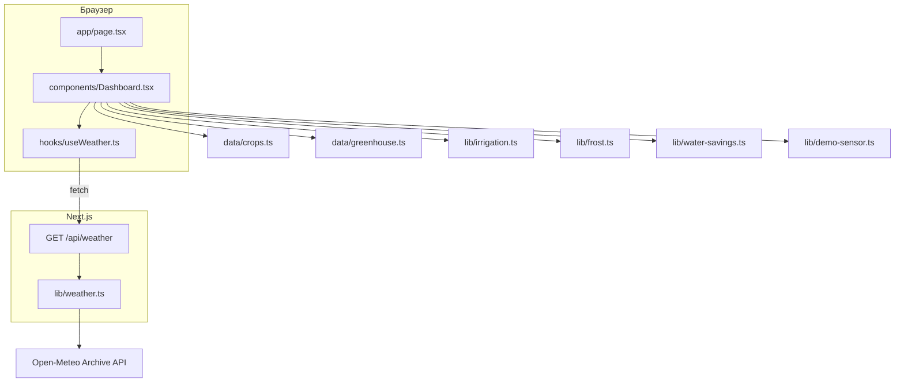

# Умный полив для Нарына

Одностраничный дашборд, который подсказывает, сколько литров воды на квадратный метр нужно грядке в Нарыне на ближайшие семь дней. Интерфейс на русском, оформление в духе SolarPunk.

## Задача

В Нарыне короткое лето, холодные ночи и дорогая вода. Обычная практика — поливать каждый день одной и той же нормой. Так легко и перелить, и пропустить заморозок.

Дашборд отвечает на три вопроса на неделю вперёд:

1. Сколько литров на 1 м² нужно сегодня выбранной культуре.
2. В какие дни полив можно пропустить.
3. В какие ночи минимум опускается до 0 °C и ниже.

Отдельный счётчик сравнивает эту норму с поливом каждый день по 6 л/м² и показывает разницу как сэкономленную воду.

Датчик влажности почвы и заряд солнечной панели на странице — демонстрация интерфейса. Это сгенерированные ряды, не показания прибора. Блок подписан «демо-данные».

## Почему прогноз из архива

Оперативный прогноз погоды на неделю уже считают физические модели. Для этого проекта ряд строится иначе: берутся те же календарные даты за пять предыдущих лет и усредняются. Так рекомендация опирается на местный климат Нарына, а не на один текущий прогон модели.

Источник — архив [Open-Meteo](https://open-meteo.com/) без ключа, точка 41.43° с.ш., 75.99° в.д., часовой пояс `Asia/Bishkek`.

Для даты `D` ближайших семи дней и для каждого года `Y` из пяти предыдущих запрашивается день с тем же месяцем и числом. По пяти значениям считается среднее:

- `temperature_2m_max`
- `temperature_2m_min`
- `precipitation_sum`
- `et0_fao_evapotranspiration` (ET₀ по ФАО, мм/сутки)

Пример для 17 октября 2026 года: архив 17 октября 2021, 2022, 2023, 2024 и 2025. Если неделя переходит через новый год, сдвигается год каждой даты, а не только первый день.

Среднее сглаживает и сухой, и мокрый год. Оно описывает типичную неделю, а не хвост распределения. Поэтому в засушливый сезон потребность в воде может оказаться заниженной, а одинокая холодная ночь пропадёт, если в остальные годы было теплее. Рекуррентная сеть на пяти годах одной точки эту дыру не закрывает: ряда слишком мало, осадки редкие, а семидневную погоду точнее описывает численная модель. Осмысленное усиление того же архива — перцентили (для полива верх ET₀ и низ осадков, для заморозка доля холодных лет), а не обучение RNN.

Ответ `/api/weather` кэшируется на сутки (`revalidate` 86400). Если год архива не открылся, падает весь запрос, и на странице показывается ошибка с кнопкой «Повторить».

## Стек

| Слой | Выбор |
| --- | --- |
| Каркас | Next.js 15, App Router, TypeScript |
| Интерфейс | React 19, одна страница `app/page.tsx` |
| Стили | Tailwind CSS 4, свои цвета SolarPunk в `app/globals.css` |
| Графики | Recharts 2 |
| Данные | Open-Meteo Archive API, ключ не нужен |
| Сборка | Turbopack в `npm run dev`, ESLint 9 |

Серверных библиотек машинного обучения нет. Вся арифметика полива — обычные функции в `lib/`.

## Архитектура

Браузер не ходит в Open-Meteo напрямую. Клиент запрашивает свой маршрут, тот собирает пять лет архива и отдаёт уже усреднённые семь дней.



`Dashboard` держит два поля состояния: выбранная культура и включена ли теплица. Прогноз от них не зависит и грузится один раз. При смене культуры или теплицы заново считаются только литры, календарь и экономия.

### Файлы

```
app/
  layout.tsx              шрифт, заголовок страницы
  page.tsx                точка входа, рендерит Dashboard
  globals.css             фон, карточки, анимации
  api/weather/route.ts    сбор архива и среднее
components/
  Dashboard.tsx           состояние и сборка блоков
  DashboardShell.tsx      шапка
  CropSelect.tsx          список культур
  GreenhouseToggle.tsx    теплица
  TodayCard.tsx           норма и вердикт на сегодня
  FrostAlert.tsx          холодные ночи
  WeatherChart.tsx        осадки, температура, ET₀
  IrrigationCalendar.tsx  семь дней полива
  WaterSaved.tsx          сравнение с ежедневной нормой
  SoilSensorDemo.tsx      демо влажности и панели
  ui/                     Card, загрузка, ошибка
data/
  crops.ts                культуры и Kc
  greenhouse.ts           множитель теплицы 1.15
hooks/useWeather.ts       клиентский fetch, loading и error
lib/
  weather.ts              даты, URL архива, среднее
  irrigation.ts           литры на м² и вердикт
  frost.ts                порог 0 °C и текст совета
  water-savings.ts        база 6 л/м² в день
  demo-sensor.ts          24 часа влажности и заряд панели
```

## Расчёт полива

ET₀ — сколько миллиметров воды за сутки испарилось бы с эталонной поверхности. Культура потребляет больше или меньше эталона. Это коэффициент Kc.

Литры на 1 м² в открытом грунте:

```
max(0, ET₀ × Kc − осадки)
```

Один миллиметр на квадратный метр равен одному литру.

В теплице дождь не попадает на грядку, воздух суше. Осадки обнуляются, ET₀ умножается на 1.15:

```
max(0, ET₀ × Kc × 1.15)
```

Вердикт «Поливать», если потребность больше 0.5 л/м². Иначе «Не нужно».

Коэффициенты культур — ориентиры среднего вегетационного периода, не измерение на конкретной грядке:

| Культура | Kc |
| --- | --- |
| Картофель | 1.10 |
| Капуста | 0.95 |
| Морковь | 0.90 |
| Свёкла | 0.90 |
| Лук | 0.85 |
| Зелень | 0.95 |
| Помидоры | 1.15 |
| Огурцы | 1.00 |

Заморозок — день, у которого средняя минимальная температура ≤ 0 °C. В календаре такой день помечен ❄. Совет один: укрыть грядку на ночь и полить почву днём, влажная земля держит тепло лучше.

Сэкономленная вода за семь дней:

```
max(0, 6 × 7 − сумма суточных норм)
```

6 л/м² — фиксированная норма «поливать каждый день», не агрономический стандарт для Нарына.

Демо-датчик строит 24 точки влажности от текущего часа: днём влажность ниже, ночью выше, плюс небольшая волна. Заряд панели зависит от часа суток и ограничен диапазоном 18–100 %.

## Что на экране

Шапка называет место и источник: архив пяти лет. Дальше выбор культуры и переключатель теплицы. Пока архив грузится, виден индикатор. Если запрос оборвался, карточка ошибки и повтор.

После ответа:

- «Сегодня» — литры, вердикт, ET₀ и осадки. В теплице осадки показаны как 0.
- Предупреждение о заморозках или спокойная карточка, если все минимумы выше нуля.
- Календарь семи дней: литры, «Полив» или «Пропуск», значок мороза.
- Сэкономлено: число и две полосы, ежедневная норма против умного полива.
- График: столбцы осадков, линия средней температуры, пунктир ET₀. Подпись указывает годы архива.
- Датчик почвы: площадь влажности за 24 часа и полоса заряда панели.

Смена культуры или теплицы заново проигрывает появление карточек. Движение отключается, если в системе включено `prefers-reduced-motion`.

## Запуск

```bash
npm install
npm run dev
```

Сайт открывается на [http://localhost:3000](http://localhost:3000). Проверка сборки: `npm run build`.

`GET /api/weather` возвращает JSON:

```json
{
  "timezone": "Asia/Bishkek",
  "source": { "basis": "historical-average", "years": [2021, 2022, 2023, 2024, 2025] },
  "daily": {
    "time": ["2026-10-17"],
    "temperature_2m_max": [14.26],
    "temperature_2m_min": [-1.36],
    "precipitation_sum": [0],
    "et0_fao_evapotranspiration": [2.69]
  }
}
```

В ответе семь дат, не одна. Годы сдвигаются вместе с календарём.

## Границы текущей версии

- Прогноз — среднее пяти лет, не перцентиль и не оперативный прогноз Open-Meteo.
- Kc не зависит от фазы роста. У картофеля и помидора в начале и в середине сезона коэффициент разный.
- Площадь грядки не вводится: все цифры на 1 м².
- Порог 0.5 л/м² и база 6 л/м² заданы в коде.
- Влажность почвы и солнечная панель не подключены к устройству.
- Один сбой года в архиве отменяет весь прогноз.
